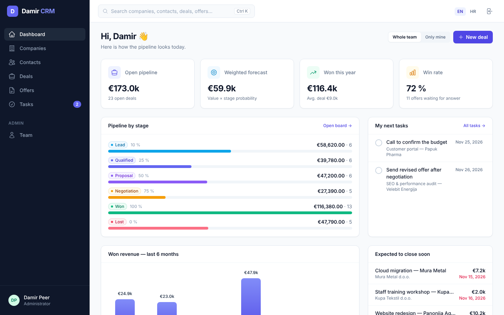
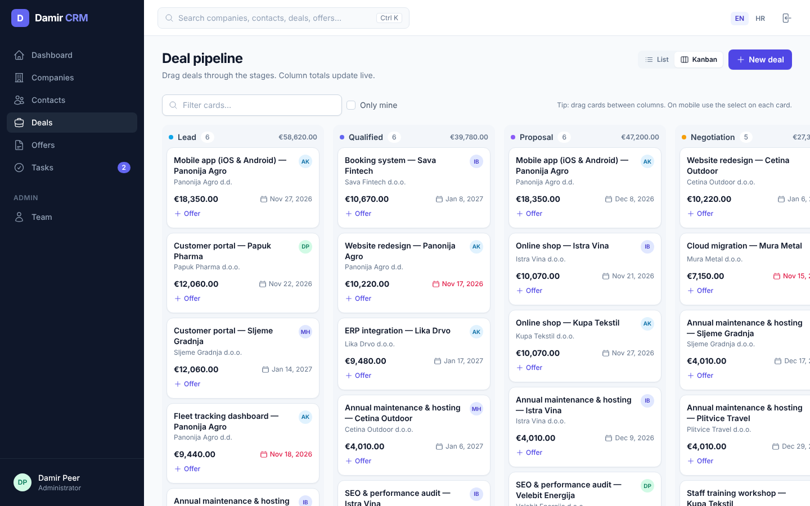
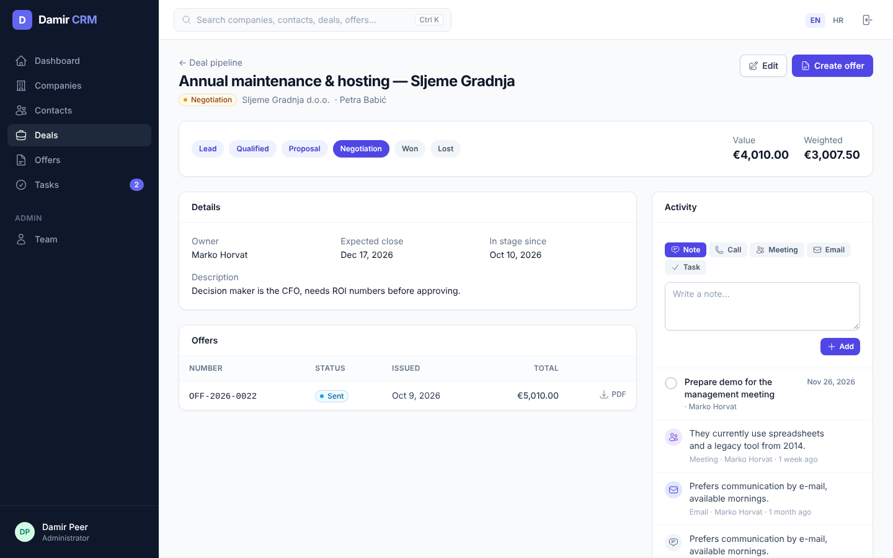
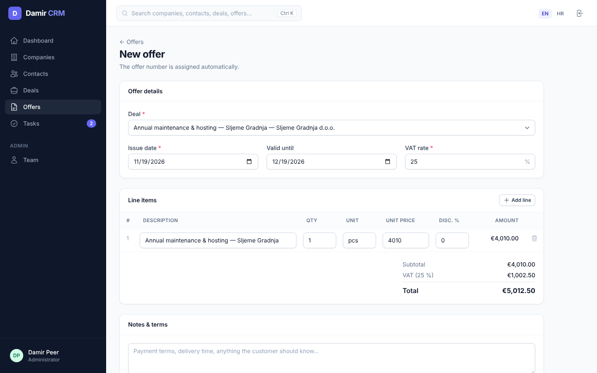
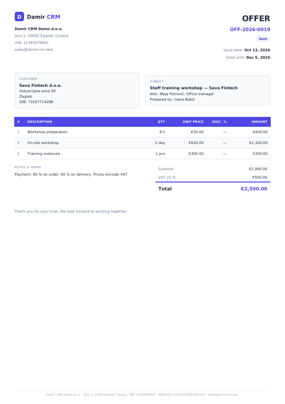
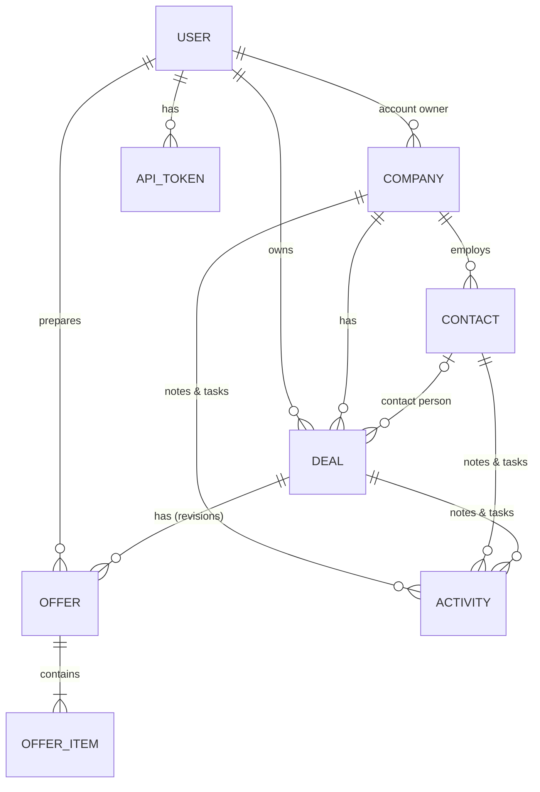

# Damir CRM

[](https://github.com/PeeroZg/damir-crm/actions/workflows/tests.yml)


A sales CRM for small B2B teams: companies and contacts, a drag & drop deal pipeline,
offers with line items, VAT and PDF export, tasks, a full audit trail and a REST API —
in English and Croatian.

**Live demo:** https://damircrm.tennisuper.com
&nbsp;·&nbsp; `admin@damircrm.test` / `demo1234` (admin) or `ana@damircrm.test` / `demo1234` (sales rep)
&nbsp;·&nbsp; data is fictional and resets every night.



---

## Features

| Area | What it does |
| --- | --- |
| **Pipeline** | Kanban boards for deals, offers, companies and contacts. Drag & drop with SortableJS (mouse + touch), live column totals, optimistic UI that rolls the card back if the server refuses the move. Dropping a deal on *Lost* asks for a reason. |
| **Deals** | Six stages with win probabilities, weighted forecast, expected close date, owner, lost reason. `closed_at` / `stage_changed_at` are maintained by the model, no matter where the change comes from. |
| **Offers** | Line items with quantity, unit, unit price and discount; VAT; totals previewed live in the browser but **always recalculated on the server**. Per-year numbering (`OFF-2026-0007`), revisions (`OFF-2026-0007-R2`), PDF export in EN/HR. Only drafts are editable — once sent, you create a revision. |
| **Business rules** | Creating or sending an offer moves the deal *forward* to *Proposal* (never backwards). Accepting an offer marks the deal as won, copies the offer value to the deal and rejects competing offers. A nightly job expires offers past their validity date. |
| **Activities & tasks** | Notes, calls, meetings, e-mails and tasks on companies, contacts and deals. Tasks have assignees and due dates, show up on the dashboard and on *My tasks*, and can be ticked off without a page reload. |
| **Audit trail** | Every create / update / delete / restore is recorded with a field-level diff (`stage: lead → proposal`) and shown as a timeline on each record and on the dashboard. |
| **Dashboard** | Open pipeline, weighted forecast, won revenue YTD, win rate, pipeline by stage, won revenue per month, deals closing soon, my next tasks, recent activity — for the whole team or "only mine". |
| **Search** | `Ctrl + K` command palette searching companies, contacts, deals and offers, with keyboard navigation and quick actions. |
| **Roles** | *Admin* and *Sales rep*. Everyone sees the shared customer base; deals and offers can only be changed by their owner or an admin. Enforced with policies in the web app **and** the API. |
| **REST API** | `/api/v1` with personal access tokens (hashed, revocable, rate limited), API resources and pagination. |
| **i18n** | Full English and Croatian UI (incl. validation messages, number/date formats and PDFs). Language is stored per user. |
| **Data quality** | Croatian OIB validation (ISO 7064 MOD 11,10 check digit), contact must belong to the deal's company, soft deletes, CSV export with formula-injection protection. |

<table>
  <tr>
    <td></td>
    <td></td>
  </tr>
  <tr>
    <td></td>
    <td></td>
  </tr>
</table>

## Tech stack

- **Backend:** Laravel 13, PHP 8.4, MySQL / MariaDB (SQLite for tests)
- **Frontend:** Blade components, Alpine.js, Tailwind CSS, SortableJS, Vite
- **PDF:** barryvdh/laravel-dompdf
- **Quality:** Pest (77 tests), Laravel Pint, GitHub Actions CI, `Model::shouldBeStrict()` (no lazy loading / N+1 in dev & tests)

## Architecture & decisions



- **Enums instead of magic strings.** `DealStage`, `OfferStatus`, `CompanyStatus`, `ContactStatus`, `ActivityType` and `UserRole` are backed enums that also carry labels, colours and (for deals) win probability — used by validation (`Rule::enum`), casts, views and the API.
- **Thin controllers, rules in one place.** Offer logic (numbering, totals, status side effects, revisions, expiry) lives in `App\Services\OfferService`, so the web UI, the API and the scheduler behave identically. Dashboard numbers come from `App\Services\DashboardMetrics`.
- **Authorization first.** Form requests call the policies in `authorize()`, so a forbidden user gets a 403 before seeing any validation details.
- **Audit log as a trait.** `App\Models\Concerns\Auditable` hooks into Eloquent events and stores a JSON diff. Polymorphic columns use a morph map (`company`, `deal`, …) instead of class names.
- **Offer numbers** are derived from existing numbers inside a locked transaction (the first version used `max(id) + 1`, which breaks with soft deletes and concurrent requests).
- **API tokens** use a ~40 line custom guard (`Auth::viaRequest`) storing SHA-256 hashes — the same idea as Sanctum's personal tokens, kept dependency-free because the API only needs bearer tokens.
- **Dashboard aggregation** groups won deals per month in PHP so it runs the same on MySQL and SQLite.
- **No public registration.** It is an internal tool: admins create users on the *Team* page.

## REST API

Create a token on the **Profile** page, then:

```bash
curl -H "Authorization: Bearer <token>" -H "Accept: application/json" \
     https://damircrm.tennisuper.com/api/v1/deals?stage=negotiation
```

| Method | Endpoint | Notes |
| --- | --- | --- |
| GET | `/api/v1/me` | Current user |
| GET | `/api/v1/companies` | `?q=`, `?status=`, `?per_page=` |
| GET | `/api/v1/companies/{id}` | Includes contacts |
| GET | `/api/v1/contacts` | `?q=`, `?company_id=` |
| GET | `/api/v1/deals` | `?q=`, `?stage=`, `?mine=1` |
| POST | `/api/v1/deals` | Same validation as the web form |
| GET | `/api/v1/deals/{id}` | Includes company, contact, owner, offers |
| PATCH | `/api/v1/deals/{id}/stage` | `{"stage": "won"}` — owner/admin only |
| GET | `/api/v1/offers` | `?status=`, `?deal_id=` |
| GET | `/api/v1/offers/{id}` | Includes line items |

Rate limit: 60 requests / minute per user.

## Running locally

Requirements: PHP 8.4, Composer, Node 20+.

```bash
git clone https://github.com/PeeroZg/damir-crm.git
cd damir-crm
composer install
cp .env.example .env          # SQLite by default
php artisan key:generate
touch database/database.sqlite
php artisan migrate --seed    # creates the demo team and data
npm install && npm run build
php artisan serve
```

Log in with `admin@damircrm.test` / `demo1234`. For MySQL set `DB_CONNECTION=mysql` and the `DB_*` variables in `.env`.

Scheduled jobs (`offers:expire` nightly, `demo:reset` when `DEMO_MODE=true`) need the usual cron entry:

```
* * * * * cd /path/to/damir-crm && php artisan schedule:run >> /dev/null 2>&1
```

## Tests

```bash
vendor/bin/pest        # 77 tests
vendor/bin/pint --test # code style
```

The suite covers authorization (web + API), stage transitions, offer totals and numbering, revisions, the accept-offer flow, PDF export, CSV export, OIB validation, search, tasks, locale switching and renders **every page for both roles with the full demo data set** (strict mode turns any N+1 query into a failing test).

## Project structure

```
app/
├── Enums/                  Deal stages, offer statuses, roles … (labels, colours, probabilities)
├── Http/Controllers/       Web controllers + Api/V1
├── Http/Requests/          Validation + authorization
├── Http/Resources/         API JSON shape
├── Models/Concerns/        Auditable, HasActivities
├── Policies/               Who can do what
├── Rules/Oib.php           Croatian OIB check digit
├── Services/               OfferService, OfferNumberGenerator, DashboardMetrics
└── Support/                Money formatting, streamed CSV
resources/views/
├── components/             Design system: button, card, badge, stat, field, layouts …
└── partials/               Kanban board, activity panel, audit timeline, command palette
lang/hr.json                Croatian UI
```

---

Built by **Damir Peer** · [github.com/PeeroZg](https://github.com/PeeroZg)
